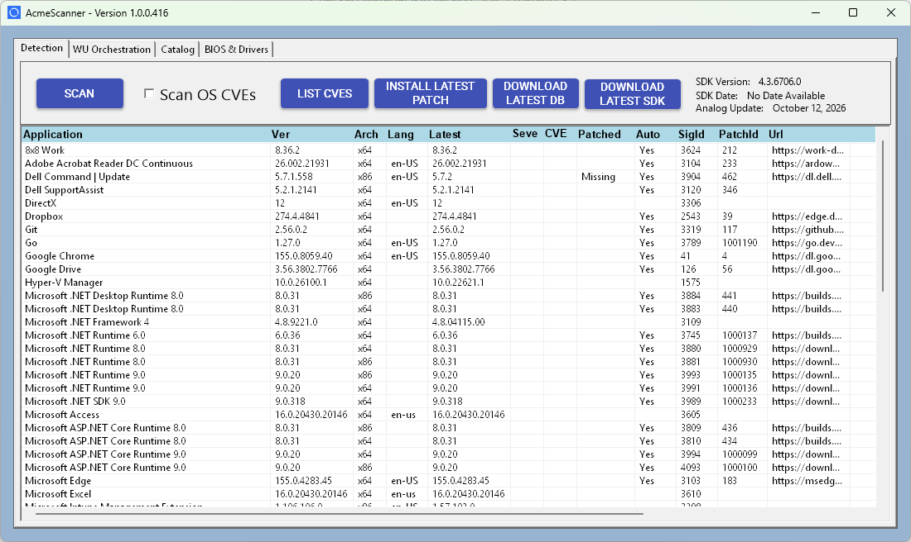

# Vuln Staging

Stages a Windows test box with third-party apps installed at **older, known-vulnerable**
versions, so OESIS vulnerability and patch detection has real findings to find — and writes a
**ground-truth manifest** to check detection against.

## Quick start: clone and run (online test box)

1. Clone the repo onto the test box.
2. Put your evaluation license in `eval-license\` at the repo root: `license.cfg`,
   `pass_key.txt` and `download_token.txt`. These are never in git; see
   `eval-license\README.md`.
3. Run:
   ```
   cd tools\vuln-staging
   run-stage.cmd
   ```

That one command does everything:
1. checks the license files,
2. sets up a portable Python plus the `requests` wheels that `sdk-downloader` needs (each
   checked against a pinned SHA-256),
3. downloads the OESIS SDK and catalog if they are not there yet (several GB; pass
   `--refresh-sdk` to re-download them),
4. runs `copy_sdk_files.py`,
5. runs `plan.py` and `fetch.py` into the bundle at `C:\vuln-staging` (set
   `VULN_STAGING_BUNDLE` to use another folder),
6. hands over to the bundle, which asks for elevation (UAC) and runs `stage.py`,
7. launches **AcmeScanner** (`tools\vapm-scanner`) so you can scan the staged box right away
   (skip with `--no-scanner`).

### AcmeScanner at the end
<a href="../vapm-scanner/docs/acmescanner-scan.png">
  
</a>

<sub>AcmeScanner after a scan. Click **SCAN** once staging finishes, and the staged apps should
show as patch `Missing` with CVEs against them. See [vapm-scanner](../vapm-scanner/README.md).</sub>

`fetch.py` builds `scanner\` in the bundle, ready to run:
- the binaries from `tools\vapm-scanner\bin`,
- the SDK DLLs,
- the engine DB files it loads from its working folder (`patch.dat`, `patchv2.dat`,
  `v2mod.dat`, `vmod.dat`, `wuo.dat`, `wiv-lite.dat`, `ap_checksum.dat`,
  `patch_driver_firmware.dat`),
- `license.cfg` and `pass_key.txt`.

`download_token.txt` is not copied, so the scanner's own Download SDK/DB buttons will not work
on an offline box; the bundled DBs are as fresh as the catalog.

AcmeScanner is a .NET 9 WinForms app and needs the **.NET 9 Windows Desktop Runtime**. That
installer also installs `Microsoft.NETCore.App` of the same version. A newer one would put a
patched .NET 9 next to the vulnerable `.NET Runtime 9.0` being staged and spoil that ground
truth. So `fetch.py` downloads the Desktop Runtime pinned to the **same version as the staged
.NET Runtime 9.0** (9.0.19 by default), checked against Microsoft's SHA-512, into `prereqs\`.
`run-stage.cmd` installs it silently before `stage.py` runs, only when no .NET 9 Desktop Runtime
is present.

That version is itself vulnerable, so the scanner may also list the Desktop Runtime. That is
expected; it is not one of the manifest's staged apps.

Nothing has to be installed first. It needs Windows 10 1803+ or Server 2019+ and internet
access. Disk: about 5 GB for the SDK and catalog plus about 3.5 GB for the bundle.

For an **offline** box, run the same command on a connected machine, copy `C:\vuln-staging`
across, and run `run-stage.cmd` from inside that copy.

## The three steps (what run-stage.cmd runs, or run them yourself)

| Step | Where | Script | Output |
|---|---|---|---|
| 1. Choose versions | any machine with the catalog | `plan.py` | `C:\vuln-staging\plan.json` |
| 2. Download | a connected machine | `fetch.py` | the bundle: installers + scripts + `sdk\` |
| 3. Install, pin, verify | the test box, **as Administrator** | `stage.py` | `results\manifest.json`, `manifest.md` |
| Undo (when done) | the test box, **as Administrator** | `cleanup.py` | `results\cleanup.json` |

For an air-gapped box, copy the whole `C:\vuln-staging` folder across after step 2. It is self
contained: the box needs nothing installed and nothing from the repo.
```
python plan.py
python fetch.py
:: on the box: double-click run-stage.cmd, or
run-stage.cmd [stage.py options]
```

### run-stage.cmd — one-step launcher
Plain batch, so PowerShell's execution policy does not block it; double-click it or run it from
a prompt. It uses only tools built into Windows 10 1803+ and Server 2019+: `curl.exe`,
`certutil` and `tar.exe`, plus a one-line `powershell -Command` for the UAC prompt, which the
execution policy does not apply to.

It detects where it is running:
- **`tools\vuln-staging` in a clone:** runs the full pipeline in Quick start above. `_run.py`
  starts each script under the portable Python, and `wheels.txt` pins the `requests` wheels.
- **A bundle folder:** steps 1–4 below.

In a bundle it:

1. asks for elevation (UAC); `--verify-only` runs without it,
2. checks the bundle is complete (scripts, `staging.json`, `sdk\`),
3. makes sure Python is available (below),
4. runs `stage.py` with any arguments you passed, echoing to the console and to `stage.log`.

**Python.** It uses the **portable embeddable Python 3.12.10** in `python\`. Nothing is
installed or registered with Windows, so it cannot collide with the Python 3.13 and 3.14
being staged, and OESIS will not detect it as a product. `fetch.py` adds it to the bundle. If
it is missing and the box is online, the launcher downloads it. Either way, the zip is checked
against a pinned SHA-256 before use. `stage.py` and `cleanup.py` use only the standard library,
so nothing else is needed. To run `cleanup.py` the same way, use
`python\python.exe cleanup.py` from an elevated prompt in the bundle folder.

## plan.py — choose a vulnerable version per app
*Usage* `plan.py [--min-cves N] [--prefer-cves N] [--fallbacks N] [--apps k1,k2] [--no-cvss] [--out PATH]`

The endpoint SDK cannot list old versions (GetPackages 50306 needs a patch_uuid; nothing maps a
signature to its versions), so versions come from `patch_aggregation_v2.json`, which holds every
version the catalog knows. For each app it keeps versions that are:

- **older than the latest** (`is_latest` records excluded),
- `data_source = opswat`, `fresh_installable = yes`,
- an **x64 package** with a SHA-256 and a download link (explicit `x86_64`, or a blank package
  arch on an x64-only record; arm64 is never picked),
- inside **at least `--min-cves` (default 1) CVE ranges** in `vuln_associations.json`.

Candidates with at least `--prefer-cves` (default 3) CVEs come first, newest first, followed by
the weaker ones; up to `--fallbacks` (default 5) older ones are kept for the download step.
Severity, CVSS 3, EPSS and KEV come from one pass over `cves.json` (`--no-cvss` skips it).
```
  App                        Pick              CVEs  Expected patch     Fallbacks
  Mozilla Firefox            156.0.1             76  157.0.1            156.0, 155.0.1, 155.0, ...
  Adobe Acrobat Reader DC    26.001.21771        32  26.002.21931       26.001.21662, 26.001.21529
  Notepad++                  8.9.7                6  8.9.8.1            8.9.6.4, 8.9.6.2, ...
  ...
  18/18 apps have a vulnerable version.
```

**Range semantics.** `ranges[].limit` is the *last vulnerable* version. Values like `9.2.999998`
show this, and the version that fixes a CVE never falls inside that CVE's range (0 of 23,496),
whichever way you read `limit`. To keep the expected list right either way, a CVE counts only
when `start <= version < limit`. CVEs where `version == limit` are listed separately as
`limit_equal_cves`. The SDK result's own CPE detail shows `version_end_exclude`, which matches
this rule.

**Expected patch** is the next `is_latest` version above the pick: the same release track for
multi-track products such as Wireshark (4.4.18 → 4.4.19, not 4.6.x).

### The app list (`_staging.py → APPS`)
Firefox, Adobe Acrobat Reader DC, Foxit Reader, Foxit PDF Editor, VirtualBox, Wireshark,
LibreOffice, VS Code, Notepad++, .NET Runtime 9, ASP.NET Core Runtime 9, Java 8, Python 3.13,
Python 3.14, Zoom, OpenVPN, 7-Zip, VLC.

This list is what the catalog can deliver. Out of every Windows product, only 22 have an older,
opswat-sourced, fresh-installable x64 version with any CVE in range; the catalog keeps only a
short window of recent versions. Left out on purpose:

- **Chrome:** old versions do not stay installed.
- **Edge:** an OS component; it cannot be downgraded.
- **Firefox ESR:** shares Firefox's install folder.

PuTTY, WinSCP, FileZilla, Git, Node.js, GIMP, KeePass and Thunderbird were tried and have no
older version in the catalog with a CVE in range. To add an app, add its Windows `v4_pid` (below
100000; 100000+ is macOS, 200000+ is Linux) and its auto-update pin to `APPS`.

## fetch.py — download and build the bundle
*Usage* `fetch.py [--bundle DIR] [--apps k1,k2] [--no-sdk] [--timeout SEC]`

For each app it tries the planned version, then each older fallback, and every download link of
each. When something fails, it moves to the next link or version:

- **HTTP 404/403/410:** no retry.
- **Timeout or connection error:** retried twice first.
- **SHA-256 mismatch:** the file is deleted and refused.

An app with nothing downloadable is marked skipped and the run **continues with the next app**.
Every attempt goes into `staging.json`, so the manifest records what was skipped and why.
```
  Notepad++
    8.9.7      .../v0.0.0/does-not-exist.exe     -> HTTP 404
    8.9.6.4    .../npp.8.9.6.4.Installer.x64.exe -> sha256 mismatch (got cb902f...)
    8.9.6.2    .../npp.8.9.6.2.Installer.x64.exe -> ok (6,898,288 bytes)
  Notepad++   8.9.6.2   11  ok fallback #2 (newer candidates unavailable)
```

- **Outside the repo.** It refuses a `--bundle` inside the repo, so installers can never be
  committed.
- **TLS.** Python on Windows does not use the OS certificate store, so it downloads with an
  unverified context (like `helloworld/python/patch.py`). The SHA-256 check here makes up for
  that, and InstallPackage checks the hash again.
- **Resumable.** An installer already on disk with the right hash is reused. `--apps` re-fetches
  some apps and keeps the earlier results for the rest.
- **SDK files.** It copies the DLLs, `license.cfg` and `pass_key.txt` from `helloworld/python/sdk`,
  and `patchv2.dat` and `v2mod.dat` fresh from `OPSWAT-SDK/extract/analog/client`. Without
  `patchv2.dat`, GetPackages and InstallPackage return -1026. Use `--no-sdk` to skip this.

## stage.py — install silently, pin, verify
*Usage* `stage.py [--apps k1,k2] [--replace-newer] [--no-pin] [--verify-only] [--bundle DIR]`

Per app, using the OESIS API only (no WMI):

1. **GetVersion (100)** for each of the app's signatures, to see what is installed now.
2. **GetPackages (50306)** for the planned patch. Its `evaluation_status` is logged.
3. **InstallPackage (50305)** with the local path and `expected_installer_sha256`. The SDK
   supplies the silent-install switches and closes blocking processes.
4. **Auto-update pin** from `APPS`, so an updater cannot undo the install:
   - Firefox: `DisableAppUpdate` policy (registry and `distribution\policies.json`), plus the
     Mozilla Maintenance service disabled.
   - Adobe: `bUpdater=0` and `AdobeARMservice` disabled.
   - VS Code: `UpdateMode=none` policy.
   - Zoom: `EnableClientAutoUpdate=0`.
   - Java: `EnableJavaUpdate=0`.
   - .NET: `BlockMU=1`.
   - Foxit: update service and tasks disabled.
   - Notepad++: `updater\` renamed.

   Apps that only notify are recorded as such. Each pin is best-effort and its result goes into
   the manifest.
5. **GetVersion** again; the run checks the target version is the one installed.
6. **GetProductVulnerability (50505)**, with `v2mod.dat` loaded via 50520. The CVEs it reports
   are compared with the CVEs the catalog says to expect.
7. **GetLatestInstaller (50300)**: what the SDK says the missing patch is.

A failure on one app is recorded and the run moves on. If a **newer** copy is already installed
the app is skipped; `--replace-newer` uninstalls it first (SDK 40000). `--verify-only` installs
nothing and re-checks the box. Run it later to catch drift: a `CONFIRMED` app that has moved off
its target version becomes `DRIFTED`.

| Status | Meaning |
|---|---|
| `CONFIRMED` | target version installed and the SDK reports at least one of the expected CVEs |
| `CVES_DIFFER` | target installed, SDK reports CVEs, none of them the expected ones |
| `NO_CVES_REPORTED` | target installed, SDK reports no CVEs, so detection has nothing to find here |
| `VERSION_MISMATCH` | detected, but not at the target version (an updater, or a failed downgrade) |
| `INSTALLER_MISSING` | `staging.json` names an installer that is not on disk (partial copy); nothing was changed |
| `NOT_DETECTED` / `INSTALL_FAILED` / `SKIPPED_*` / `ERROR` | see `steps` / `error` in the entry |

**When something is missing,** `run-stage.cmd` checks the bundle *before* asking for elevation.
It lists every missing item, says what each one is, and says how to fix it:

- **Run from the repo's source folder:** says to build the bundle with `fetch.py`.
- **Run from a mapped drive or share:** says to copy the bundle to a local folder.
- **Missing scripts, `staging.json`, `installers\` or `sdk\` files:** each one is listed with
  its fix.

`stage.py` then lists any app with no installer and any installer file missing from disk, and
skips those apps without touching them. If the SDK fails to start, it points at the license and
databases in `sdk\`.

### The manifest
`results\manifest.json` has one entry per **product**. One install can match two signatures
(Notepad++ exe x64 3241 and msi x64 4127). The API gives no install path to dedupe on, so the
entry lists every signature it was detected on and checks CVEs on the ones at the target
version. Each entry holds:

- signatures, target and installed version, release date
- installer file, **SHA-256**, URL, package_uuid and patch_uuid
- **expected patch version** (catalog) and the SDK's latest-installer answer
- **expected CVEs** with severity, CVSS 3, EPSS and KEV, plus `limit_equal_cves`
- the SDK-reported CVEs, split into matched, expected-not-reported and reported-not-expected
- auto-update pin results, and the fallbacks that were skipped (with reasons)

`results\manifest.md` is the same thing as two tables.

## cleanup.py — undo the staging
*Usage* `cleanup.py [--apps k1,k2] [--keep-apps] [--keep-pins] [--include-preexisting] [--dry-run] [--bundle DIR]`

Run on the test box, as Administrator, from the same bundle. It reads `results\manifest.json`
(what `stage.py` did) and `staging.json` (the pin definitions), and per app:

1. **Uninstall** with UninstallProduct (40000) on every signature the app was detected on, but
   **only if `stage.py` installed it**. An app that was already on the box before staging stays
   installed unless `--include-preexisting` is given.
2. **Undo the auto-update pins `stage.py` applied** (a pin it never applied is left alone):
   registry values put back or deleted, services back to their start type, tasks re-enabled,
   `updater.disabled` renamed back, Firefox's `DisableAppUpdate` removed (and `policies.json`
   deleted if `stage.py` created it). A pin two apps share (.NET's `BlockMU`) is undone once.
3. **GetVersion** again, so the report shows anything still installed.

```
Start-Process cmd.exe -ArgumentList '/c cd /d C:\vuln-staging && python\python.exe cleanup.py --dry-run > cleanup.log 2>&1' -Verb RunAs -Wait
Start-Process cmd.exe -ArgumentList '/c cd /d C:\vuln-staging && python\python.exe cleanup.py > cleanup.log 2>&1' -Verb RunAs -Wait
```

`--dry-run` lists what would happen and changes nothing (it does not need elevation). The report
goes to `results\cleanup.json`; the manifest is not changed.

What it cannot do:
- **Restore a replaced version.** A newer copy `stage.py` removed with `--replace-newer`, or an
  older copy it installed over, is gone; the report lists these under `not_restorable`.
- **Restore exact settings from an older manifest.** `stage.py` records each pinned setting's
  previous value from this version on. A manifest written before that (or by running `stage.py`
  twice) only says the pin was applied, so the setting goes back to the app's default: policy
  value deleted, service set to demand-start, matching tasks re-enabled.

## Notes
- **CVEs are confirmed only after install.** 50505 returns -1005 for a product that is not
  installed, even with a `version` argument, so the SDK cannot check a version in advance. The
  plan relies on `vuln_associations.json` (what `v2mod.dat` is built from); `stage.py` confirms
  each app with the SDK.
- **GetVersion returns `0.0` with rc 0** for a signature that is not installed; `stage.py` treats
  that as absent.
- **Never commit** installers, `license.cfg`, `pass_key.txt`, `download_token.txt` or `.dat`
  files. They all live in the bundle, outside the repo.
